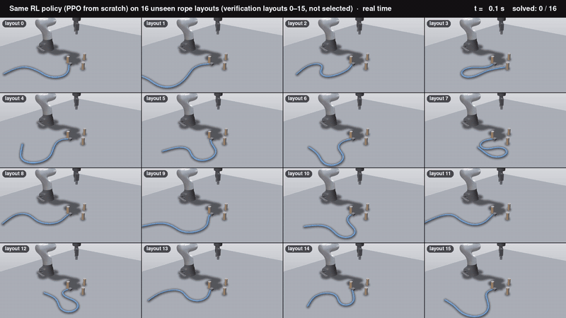

# Rope routing with an object-agnostic deformation representation

A Franka FR3 arm with a Robotiq 2F-85 gripper picks up a soft rope in the SuperDex simulator and routes it around three
pegs into a triangle. The policy is trained from scratch with reinforcement learning only (asynchronous PPO); no
demonstrations, behaviour cloning or scripted expert are used. The observation and the reward describe the rope through
the first and second fundamental forms of its boundary surface (surface stretch and curvature), and the goal is a target
surface matched without point correspondences, so the formulation itself applies to any deformable object with a surface
mesh.

**Results of the final policy** (10M environment steps, deterministic):

| Evaluation | Success | Still wrapped after the gripper releases |
|---|---|---|
| 100 unseen layouts, nominal rope | 87% (95% CI 79-92%) | 82% |
| 100 unseen layouts, randomized rope physics | 88% (95% CI 80-93%) | 76% |

Success means the rope is held, every peg is wrapped by at least 85% of the target's winding angle, and the target
surface is covered within 2.5 cm. Most failures under randomized physics occur on ropes softer than the training rope.

*A pure-RL policy on 16 unseen rope layouts (verification layouts 0-15, not selected), shown at 2x speed. Click the
preview for the full 1080p video in real time. This recording is of the earlier policy (`surf_ppo2`), trained in the
predecessor environment with gripper waypoints; see notes D.*

## Repository layout

| Path | Contents |
|---|---|
| `rope_routing/task/` | Task geometry: peg layout, target route, winding angle (`geometry.py`); random initial rope layouts (`rope_init.py`) |
| `rope_routing/sim/` | SuperDex scene: FR3 + 2F-85, anchored rope, pegs, table (`grasp_scene.py`); wrist camera (`wrist_camera.py`) |
| `rope_routing/deformation/` | Deformation measures: fundamental forms on triangle meshes and the rope's tube surface (`surface_forms.py`), material samples (`material_graph.py`), legacy point-based measures |
| `rope_routing/env/` | Gymnasium environments. `generic_surface_env.py` is the final, object-agnostic environment; `surface_route_env.py` and `grasp_route_env.py` are its predecessors (still used for the robot interface and the earlier policy); `start_states.py` builds curriculum start states |
| `rope_routing/rl/async_ppo.py` | Asynchronous PPO trainer, evaluation and checkpoint loading |
| `scripts/` | Entry points: training, verification, randomized evaluation, video rendering |
| `tests/` | Unit and integration tests (`pytest`) |
| `assets/fonts/` | Fonts used in the rendered videos |
| `data/` | Generated data, not tracked by git: `data/runs/` (checkpoints, logs, evaluation results, videos) and `data/tools/` (a static ffmpeg build with NVENC) |

Detailed notes, including the derivations behind each design choice, are in `docs/` (A: deformation math,
B: RL environment, C: physics and infrastructure, D: results, E: code workflow).

## Deformation formalization

Every deformable object is represented by a triangle mesh of its boundary surface with fixed connectivity. For a rope
this is the tube around the simulated centreline; for cloth it would be the sheet, and for a soft body the skin of its
volume mesh. Deformation is measured on that surface with the two fundamental forms of differential geometry:

* **First fundamental form (the metric):** lengths and areas. It gives the area stretch `J = dA / dA0` and the membrane
  strain `E = (g - g0) / 2` of each surface patch.
* **Second fundamental form:** how the surface normal turns. It gives the mean curvature `H`, the Gaussian curvature
  `K` and the principal curvatures.

By Bonnet's theorem the two forms determine the shape of the surface up to a rigid motion, so together they describe
the object's deformation completely; its position in space is described separately.

The discrete estimators (`deformation/surface_forms.py`, class `SurfaceMeshForms`) are the standard ones of discrete
differential geometry: per-face metrics from edge lengths, mixed Voronoi vertex areas, the cotangent Laplacian for `H`,
the angle defect for `K`, and the Gauss-image moment for the integrated curvature vector. `TubeSurfaceDescriptor`
builds the rope's tube mesh from the simulator's 61 centreline nodes every step, summarises the measures over 21
material samples along the rope, and detects and corrects folds of the tube at sharp hairpins.

## RL design

**Action (5 values in [-1, 1], every 0.1 s):** move the gripper target by up to 2 cm per axis, rotate it by up to
0.15 rad, and set the finger closure. While the rope is held, the fingers open only after three consecutive release
commands, so exploration noise cannot drop the rope. Each control step runs 10 physics substeps of 10 ms.

**Observation (602 values):** the robot state; for each of the 21 material samples its position and velocity relative
to the gripper, area stretch, mean and Gaussian curvatures, curvature vector and a validity flag; two global measures
(total area stretch and bending energy); 48 farthest-point samples of the target surface relative to the gripper, with
their target Gaussian curvature; the current coverage and curvature mismatch; the potential; the nearest point of the
object's far region; and each obstacle's position and wrap fraction. No point of the rope, peg or path is named.

**Goal:** a target surface. Here it is the tube surface of a rope lying along the triangle route; for another object it
would be any target mesh.

**Reward:** progress shaping on a potential `phi`, plus regularisers.

    phi = 2 [object held] + 2 * sum(wrap fractions) - 10 * coverage - 0.3 * curvature mismatch   (- 3 * reach before grasping)
    reward = 10 * (phi' - phi) - stretch penalty - small action, smoothness, table and time costs + 20 on success

* *Coverage* is the mean distance from every target-surface vertex to the nearest vertex of the current surface. It is
  correspondence-free: no part of the object is assigned to any part of the target.
* *Curvature mismatch* compares the Gaussian curvature (second fundamental form) at those nearest pairs, so the object
  must also bend like the target.
* The *stretch penalty* uses the area stretch (first fundamental form).
* The *wrap fraction* of an obstacle is the object's winding angle around it divided by the target surface's winding
  angle; obstacles are an unlabelled list of cylinders.
* *Reach* pulls the gripper toward the object's far region before grasping: the 15% of the surface farthest, in rest
  geodesic distance, from the material that is held fixed. This generic grasp rule was needed because, without it, the
  policy consistently grasped the rope next to its anchor, from where the route cannot be completed.

The shaping uses `phi' - phi` (shaping discount 1) rather than the strictly policy-invariant `gamma * phi' - phi`; with
the policy-invariant form the policy did not learn.

**Start states and exploration:** an adaptive curriculum mixes episodes that start from the home pose, from a hover
above a random point of the rope, or with the rope already grasped at a random point. Half of the training episodes
that start from home first move the gripper to a random position above the rope, so the policy experiences grasps all
along the object. Evaluation always starts from the home pose.

**Trainer:** asynchronous PPO (`rl/async_ppo.py`) with 24 CPU simulator workers and a GPU learner; gamma 0.99,
GAE lambda 0.95, clip 0.2, 8 epochs, minibatch 2048, a KL-adaptive learning rate (target 0.01), separate 512-512-256
actor and critic networks, observation normalisation and reward scaling. A held-out evaluation on 64 layouts runs every
1M steps and selects `best.pt`. SuperDex simulates one scene per CPU core, so training speed is set by the number of free
CPU cores rather than by GPUs (notes C).

## Recreating the results

**1. Simulator.** Set up SuperDex (Python 3.12) following its README, for example in `../project_superdex`:

    cd ../project_superdex && uv venv && uv pip install superdex

**2. This package.** Clone it next to SuperDex as `rope_routing`, install it in editable mode into the same environment, then run the tests:

    git clone https://github.com/RSSarav/PPO-Deformation-Manipulation-Policy.git ../rope_routing
    uv pip install -e "../rope_routing[video,test]"
    .venv/bin/python -m pytest -q ../rope_routing/tests

**3. Train** (about 6-7 hours with 24 workers on a 64-thread machine; checkpoints go to `data/runs/<run>/`):

    .venv/bin/python ../rope_routing/scripts/train_rl.py --run final \
        --env rope_routing.env.generic_surface_env:make_env --env_kwargs '{"roam_prob": 0.5}' \
        --steps 10000000 --workers 24 --n_eval_workers 6

The reported checkpoint was trained in stages that resumed from one another while the reward was being developed
(notes B, run history): 2.4M steps without the grasp rule, 1.1M steps with randomized gripper starts added, 1.7M steps
with a 30% far region, and the remaining steps with the final 15% far region. The single command above trains the final
configuration from scratch.

**4. Verify** on the 100 held-out layouts, including the release-and-hold test:

    .venv/bin/python ../rope_routing/scripts/verify_rl.py --run final --model best --n 100

**5. Randomized rope physics** (mass, three stiffnesses, damping and friction drawn per episode):

    .venv/bin/python ../rope_routing/scripts/eval_randomized.py --run final --model best --n 100

**6. Videos** (optional; needs an EGL-capable GPU). `render_hd.py` renders single episodes with third-person, top and
wrist cameras and live deformation charts; `render_eval_set.py` renders the 12 successes and 12 failures of the
randomized evaluation and composes the grids. GPU encoding uses a static ffmpeg build with NVENC placed in
`data/tools/ffmpeg_nvenc/`; without it the renderer falls back to CPU encoding. The EGL and GPU indices in
`render_eval_set.py` are set for the machine used here and may need adjusting.

## Limitations

* The goal, reward and deformation measures are object-agnostic, but the adapter that builds the rope's surface mesh
  and material samples is rope-specific, a few observation features are scaled by the rope radius, and two features
  (the centreline curvature vector and the signed planar curvature) are defined only for curves.
* The trained policy is specific to this task; another object needs its adapter, a target mesh and a new training run.
* The grasp rule is a designed prior, not learned.
* About 1 in 7 successful episodes with randomized rope physics does not stay wrapped after release.
