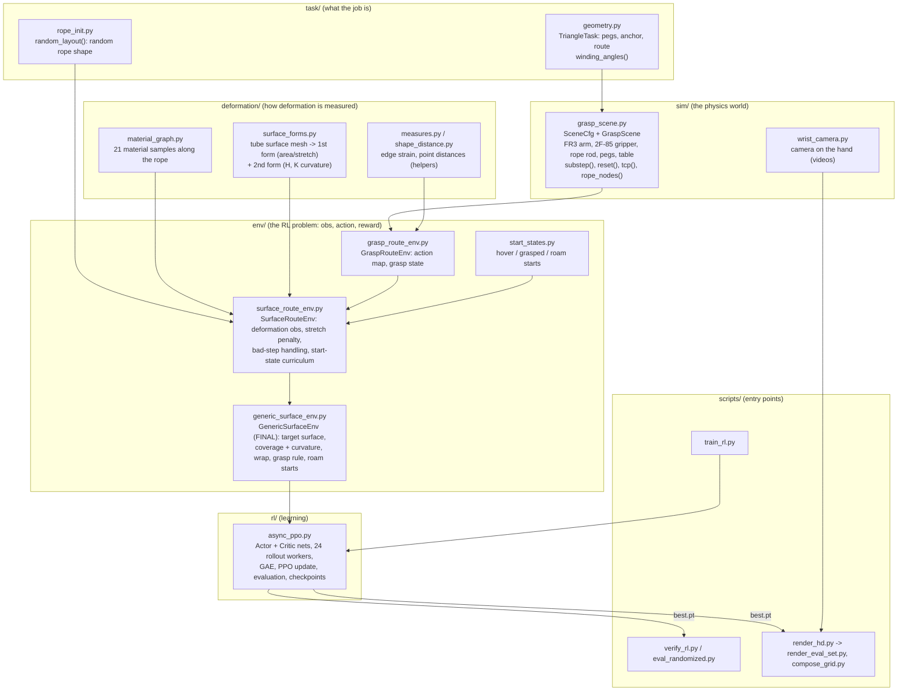

# E. How the code fits together (workflow diagram + walkthrough order)

## 1. The big picture


## 2. One control step (every 0.1 s)
```
policy(obs) ──► action a (5 numbers: dx dy dz dyaw grip)
                     │
GenericSurfaceEnv.step(a)
   ├─ _apply_action(a): move the gripper TARGET by ≤2 cm, rotate ≤0.15 rad, set the finger command
   ├─ _simulate(): 10 × GraspScene.substep()  (10 ms each: controller torques → Mochi physics step)
   ├─ _measure(): rope nodes → TubeSurfaceDescriptor → area stretch + curvature per sample;
   │              wrap fraction per obstacle; gripper position
   ├─ _potential(): φ = grasp bonus + 2·Σwrap − 10·coverage − 0.3·curvature mismatch (− 3·reach if not held)
   ├─ reward = 10·(φ_new − φ_old) − stretch penalty − small action/time costs (+20 success, −10 sim failure)
   └─ _make_obs(): 602 numbers (robot, 21×17 deformation features, target surface samples, obstacles, wraps)
                     │
                     ▼
          next obs, reward, done ──► PPO worker stores it; the learner updates the networks
```

## 3. Training loop (async_ppo.py)
```
train_rl.py ─► AsyncPPO(cfg).train()
   setup: spawn 24 RolloutWorker processes (each builds its own env = its own physics world)
   repeat:
     _collect(): every worker runs the current policy for ~256 steps (slow ones are stopped early)
     _batch():   GAE advantages  A = Σ (γλ)^k δ_k,  δ = r + γV(s′) − V(s)
     _update():  8 epochs of PPO (clipped policy loss + value loss), learning rate adapted to KL
     every 1M steps: checkpoint + held-out evaluation on 64 layouts → best.pt
```

## 4. Walkthrough order (data flows bottom-up)
1. `task/geometry.py`, `task/rope_init.py`: the task definition
2. `sim/grasp_scene.py`: the physics world
3. `deformation/material_graph.py`, `measures.py`, `shape_distance.py`, `surface_forms.py`: deformation measures
4. `env/grasp_route_env.py` → `env/start_states.py` → `env/surface_route_env.py` → `env/generic_surface_env.py`: the RL problem
5. `rl/async_ppo.py`: the learner
6. `scripts/train_rl.py`, `verify_rl.py`, `eval_randomized.py`: running and evaluating
7. `sim/wrist_camera.py`, `render.py`, `viz.py`, `scripts/render_hd.py`, `render_eval_set.py`, `compose_grid.py`: videos
8. `scripts/check_scene_physics.py`, `test_start_states.py`, `egl_probe.py`: utilities
